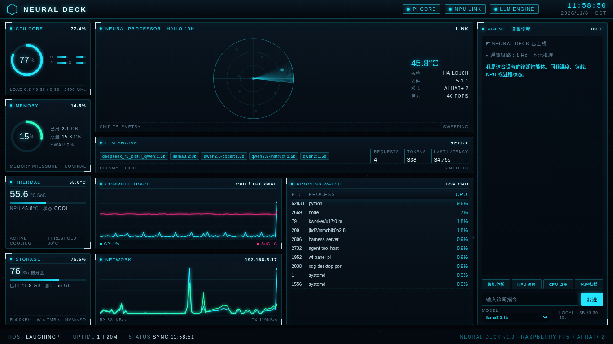

# NEURAL DECK

树莓派 5 + AI HAT+ 2（Hailo-10H）的科幻风实时性能观测台，内置一个完全本地运行的设备诊断 Agent。



## 特性

- **1 Hz 实时遥测**：CPU（总占用 / 四核 / 频率 / 负载）、内存、SoC 温度、磁盘、网络收发、Top 进程
- **Hailo-10H 状态**：芯片温度、架构、固件版本、板卡型号，雷达扫描可视化
- **本地 LLM 面板**：模型列表、请求数、生成 token 数、最近一次推理延迟
- **诊断 Agent**：对本地 hailo-ollama 发起真实工具调用，再生成中文结论
- **一屏自适应布局**：按窗口实际像素重排；浏览器缩放、高 DPI 都不会出现空白或裁切
- **纯本地**：除字体 CDN 外无外部依赖，数据不出设备

## 技术栈

| 层 | 实现 |
|---|---|
| 后端 | FastAPI + uvicorn，WebSocket 推送，psutil 采集 |
| 前端 | 原生 HTML/CSS/JS + Canvas（星空、雷达、折线图） |
| NPU | `hailo_platform`（pyhailo）读芯片温度，`hailortcli` 读静态信息 |
| 推理 | hailo-ollama（Ollama 兼容 API，默认 `:8000`） |

## 运行时序

```text
psutil / pyhailo / hailo-ollama
        │  1 Hz 采集
        ▼
   FastAPI (app.py) ──WS /ws/metrics──▶ 前端大屏
        │                                │
        ├──WS /ws/agent──▶ ReAct 式 Agent ◀┘ 用户提问
        │                   │
        │        ┌──────────┴──────────┐
        │        ▼                     ▼
        │   planner 输出 JSON     工具取真实数据
        │        └──────▶ 代码侧风险判定 ──▶ LLM 仅润色结论
        ▼
   hailo-ollama (127.0.0.1:8000)
```

## 快速开始

需要：Raspberry Pi 5、AI HAT+ 2、已安装并可用的 `hailo-ollama`。

```bash
git clone git@github.com:Laughingxue/pi-neural-deck.git
cd pi-neural-deck

python3 -m venv .venv
source .venv/bin/activate
pip install fastapi uvicorn psutil httpx websockets

python app.py
```

浏览器打开 `http://<树莓派IP>:8080`。

### 可选环境变量

| 变量 | 默认值 | 说明 |
|---|---|---|
| `HUD_OLLAMA` | `http://127.0.0.1:8000` | hailo-ollama 地址 |
| `HUD_MODEL` | `qwen2.5-instruct:1.5b` | 兜底模型；页面可切换 |

### 接口

| 路径 | 类型 | 说明 |
|---|---|---|
| `/` | GET | 仪表盘页面 |
| `/api/metrics` | GET | 当前指标 + 90 点历史 |
| `/api/health` | GET | 存活探测 |
| `/ws/metrics` | WebSocket | 每秒推送指标 |
| `/ws/agent` | WebSocket | 诊断 Agent 会话 |

## 诊断 Agent

- **工具**：`system`（CPU/内存/温度/磁盘）、`processes`（Top 进程）、`hailo`（NPU 温度与状态）、`llm`（模型与推理统计）、`network`、`all`（整机体检）
- **流程**：planner 先选工具（失败时按关键词兜底路由）→ 取真实数据 → 代码侧阈值判定风险 → 小模型只负责把已核实的数据写成 2–3 句结论
- **防幻觉**：数字与风险等级全部由代码计算，提示词禁止模型自行编造读数
- **模型选择**：页面底部可切换；默认优先 `llama3.2:3b`（约 30–40 s，稳定），`qwen2.5-instruct:1.5b`（更快，适合短问答）

NPU 温度探针每 12 s 读取一次，Agent 推理期间自动暂停，避免与推理任务抢占 Hailo 设备。

## systemd 开机自启

`systemd/` 下提供两个单元文件，**使用前请把 `User` 和 `WorkingDirectory` 改成你自己的**。

```bash
sudo cp systemd/hailo-ollama.service systemd/neural-deck.service /etc/systemd/system/
sudo systemctl daemon-reload
sudo systemctl enable --now hailo-ollama.service neural-deck.service
```

## 布局说明

- 宽度 ≥ 901px 且高度 ≥ 880px：左（系统）/ 中（NPU、LLM、曲线、网络、进程）/ 右（Agent）三列完整布局
- 高度 < 880px：紧凑一屏布局，NPU 通栏、LLM 横排信息带、PROCESS 通高
- 宽度 < 900px：单列滚动
- 进程表按面板实际高度逐行填充，不裁切

## 常见问题

**HailoRT 报动态库错误**
IDE 注入的 `LD_LIBRARY_PATH` / `LD_PRELOAD` 会污染 HailoRT，启动前清掉：

```bash
env -u LD_LIBRARY_PATH -u LD_PRELOAD python app.py
```

**Agent 很慢或数字不对**
先确认 `hailo-ollama` 在 8000 端口且模型已加载：`curl http://127.0.0.1:8000/api/tags`。若模型文件损坏（0 字节），用 `POST /api/pull`（字段名是 `model`）重新拉取。

## 仓库

https://github.com/Laughingxue/pi-neural-deck
